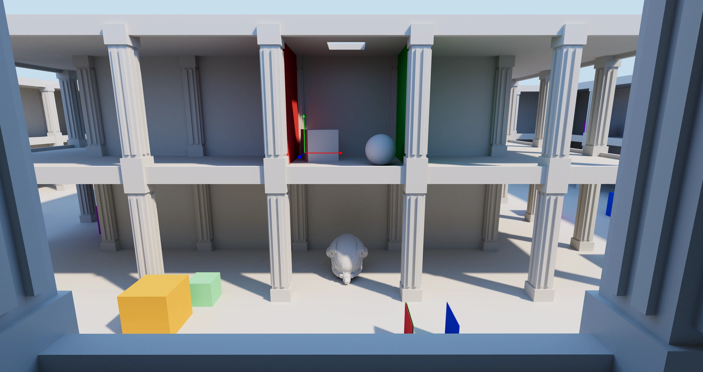
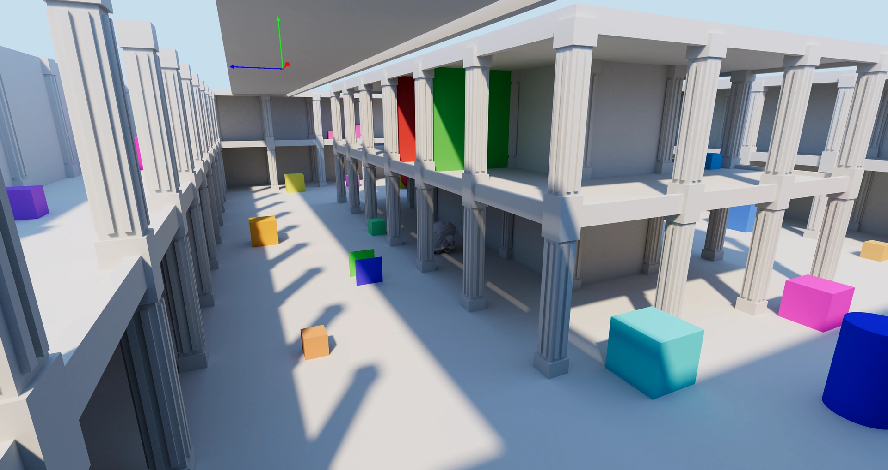
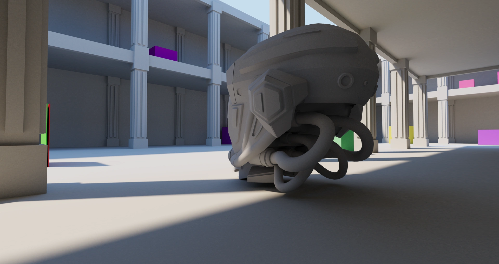
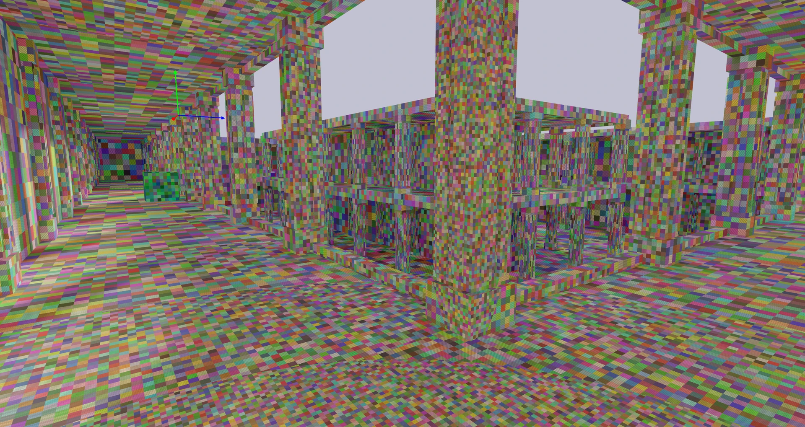

# virtualLightmap

**[Live demo](https://johanholwerda.github.io/virtualLightmaps/)** (needs a browser with WebGPU)

Irradiance cache by storing a virtual lightmap that is accessed by a hash map. The quality seems to be higher than that of other irradiance cache methods. This is useful when pre-baked lightmaps would take too much memory or when the lightmap needs to be updated because of a change in scene geometry or lighting, or when a high lightmap resolution is needed when a surface is seen from up close. It has a LOD / mipmap structure so surfaces close by have more resolution than surfaces far away. The lightmap size and resolution in this example are set in a way that the lightmap cannot hold the whole scene so moving the camera around will continuously create and evict lightmap tiles. A larger scene would not bring the lighting quality down. The scene is continuously pathtraced while lightmap tiles are not converged. 









How it works:

- The screen is split up in cells (4x4 pixels at 1080p, scaled with the resolution so the work doesn't grow with it).
- Each cell gets a random pixel in the cell, a different one every frame.
- From the surface under that pixel a hash is made of: the face of the model it is on (6 per primitive, a UV chart for a mesh), the texel level (texels sized so there are about `texelsPerPixel` texels per screen pixel, so coarser at a distance and at grazing angles) and the 8x8 texel tile of that face and level the pixel falls in.
- The hash is looked up in a hash map with linear probing. A tile that isn't there yet is inserted in an empty slot, or takes the slot of a tile that was unused for `evictFrames` frames. The slot is also where the texels of the tile are in the lightmap, so 1 lookup gives the whole tile. Only the tiles that are seen get a place, at the resolution they are seen at.
- The tiles of the 2 coarser levels above it are found or inserted too.
- Every cell bids a random number on its texel, and only the highest bid of a texel traces this frame (the claim, select and trace passes). A texel that holds `accumulationMax` paths is converged and takes no more, so the cost follows the texels that are still converging, not the screen.
- The winning cell traces `sampleCount` paths from its pixel. A path ends at its first hit, in the lighting the lightmap has there: the lightmap is its own radiance cache, so the bounces build up over the frames.
- The result goes into the running average of the texel and of its coarser texels. A new texel starts from the lighting of the coarser one instead of from its first noisy sample.
- The resolve looks up the texels of every pixel in the 2 levels around its level, interpolates the 4 nearest texels (never across faces) and blends the levels, or picks 1 by noise when TAA follows. A texel with few paths leans on the smoother coarser level.
- A tile that is out of view keeps its lighting until its slot is needed. While the sun moves the texels hold a short history (`changeFrames`), and a dragged model only resets the texels it has influence on (around it and in its shadow).

Object can be moved after clicking them, and the lightmap will update. The lightmap is also updated when the sun moves. Quality is lower while anything is moving. The lightmap might need a reset to remove artifacts. This part of the code can be improved.
The sampling of the scene is done with raytracing and this is most of the cost. Other irradiance caching techniques have been added to compare cost / quality.

## Running

```
npm i
npm run dev
```

Other commands: `npm run build` (to `dist`), `npm run preview` and `npm run typecheck`.

